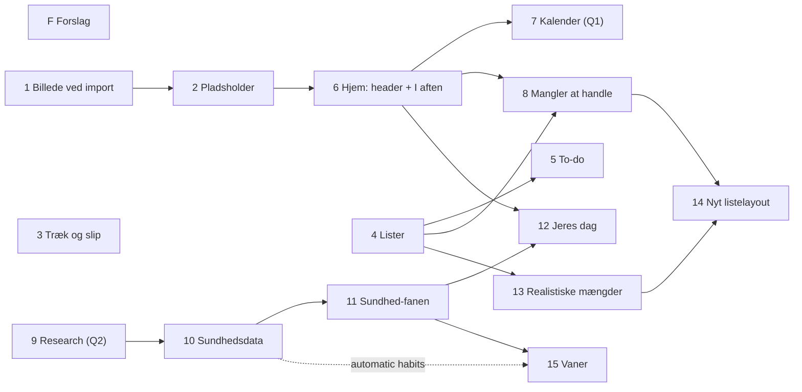

# Strandparken: idéer (Nov 2026) — Roadmap and Plan Index

> **For agentic workers:** this file is an index. Each idea has its own implementation plan (linked below). Build them one at a time, in the order of the table, as the source document asks. Read this file's "Decisions" section before starting any plan: several ideas change agreed decisions in the main spec.

**Source:** `docs/app_ideer_-_strandparken_rettet.docx` (15 ideas with mockups; not committed, keep it out of git), plus one request from Jonas on 2026-11-24: a Forslag feature in `/strandparken/` like the one in `/ferie/`, which creates a GitHub issue.

**Specs these plans change:** `docs/superpowers/specs/2026-11-11-strandparken-design.md` (the "main spec") and `docs/superpowers/specs/2026-11-12-strandparken-ui-design.md` (the "UI spec"). Every plan ends with a task that updates the spec sections it supersedes, per the definition of done (main spec §9.3).

**Status:** Draft, 2026-11-24. The questions in "Decisions" have a recommended default. Plans that depend on one name it and assume the default.

---

## Plans

> **Progress (2026-11-24):** F and 1–15 are implemented and pushed to `main`; the habits migrations are applied to production and `health-sync` and `feature-chat` are redeployed. Browser checks on both phones are still outstanding. All decision gates are answered: Q1 = A (iCal feeds), Q2 = ADR-06 (Oura for Camilla, Garmin Personal API for Jonas, manual cycle log), Q9 = commit everything. Q4 and Q5 (habits) use the defaults. Outstanding manual checks, secrets and setup steps are in `docs/strandparken-manual-checks.md`; health and calendar collect nothing until those secrets are set.

| Status | # | Plan | Size | Depends on | Gate |
|---|---|---|---|---|---|
| ✅ Done | F | [Forslag i Strandparken](2026-11-24-strandparken-forslag.md) | S | – | None. Can go first; it gives Camilla a way to send wishes while the rest is built. |
| ✅ Done | 1 | [Billede af retten ved import fra link](2026-11-24-sp-01-recipe-photo-import.md) | M | – | – |
| ✅ Done | 2 | [Pænere pladsholder uden billede](2026-11-24-sp-02-dish-placeholder.md) | S | (1) | – |
| ✅ Done | 3 | [Flyt retter i Madplan med træk og slip](2026-11-24-sp-03-madplan-drag.md) | M | – | – |
| ✅ Done | 4 | [Ny fane "Lister" med Indkøb](2026-11-24-sp-04-lister-tab.md) | S | – | – |
| ✅ Done | 5 | [To-do-liste under Lister](2026-11-24-sp-05-todo.md) | M | 4 | Q3 |
| ✅ Done | 6 | [Nyt Hjem, del 1: header og I aften](2026-11-24-sp-06-hjem-header-tonight.md) | S | 2 | – |
| ✅ Done | 7 | [Kalender på Hjem](2026-11-24-sp-07-hjem-calendar.md) | L | 6 | **Q1: Jonas must choose the calendar approach before build** (the source document asks for this). |
| ✅ Done | 8 | [Mangler at handle på Hjem](2026-11-24-sp-08-hjem-shopping.md) | S | 4, 6 | – |
| ✅ Done | 9 | [Undersøg Oura og Garmin (research only)](2026-11-24-sp-09-health-research.md) | S | – | Ends by waiting for Jonas's go-ahead (Q2). |
| ✅ Done | 10 | [Forbind sundhedsdata](2026-11-24-sp-10-health-integration.md) | L | 9 | Q2, Q6 |
| ✅ Done | 11 | [Sundhed-fanen](2026-11-24-sp-11-sundhed-tab.md) | M | 10 | Q6 |
| ✅ Done | 12 | [Jeres dag på Hjem](2026-11-24-sp-12-hjem-jeres-dag.md) | S | 6, 11 | – |
| ✅ Done | 13 | [Realistiske mængder på indkøbslisten](2026-11-24-sp-13-shopping-amounts.md) | L | 4 | – |
| ✅ Done | 14 | [Nyt layout på indkøbslisten](2026-11-24-sp-14-shopping-layout.md) | M | 4, 8, 13 | – |
| ✅ Done | 15 | [Vaner i Sundhed](2026-11-24-sp-15-habits.md) | L | 11 (manual habits need only the Sundhed segment) | Q4, Q5; automatic habits need 10. Migration not yet applied to production |

Ideas 9 to 12 and the automatic habits in 15 cannot start until the health data source is decided. While waiting on Q1 or Q2, continue with 13 and 14, which carry no external risk.

---

## What already exists (as found on 2026-11-24)

- **Phase 1 food core is built:** recipes (`sp_recipes` has `image_path` and `thumb_path`; photos are shrunk to 1600 px in the browser by `lib/recipes/repo.ts`), link import (`supabase/functions/recipe-import`, hardened fetch in `fetch.ts`, but it **does not extract the dish photo**), Madplan with move and swap inside the visible week (`madplan/DaySheet.tsx`, `lib/madplan/repo.ts`), Indkøb with per-source rows (ADR-08) and offline queue (ADR-09), Hjem v1 (`home/Tonight.tsx`: I aften plus a "Resten af ugen" strip), ideas, profiles and AI suggestions.
- **Shopping rows already link to the plan entry:** `sp_shopping_items.plan_entry_id` (with `source = 'plan'`). Idea 8 needs no new link.
- **Not built:** Sundhed (placeholder), habits, tasks, Husholdning, Økonomi, Google Calendar, health integrations, Forslag in Strandparken.
- **Dependencies already installed** that the plans reuse instead of adding new ones: `@dnd-kit/core` (drag and drop, idea 3), `motion` (swipe and lift animation, ideas 3, 5, 14), `lucide-react` (icons), `radix-ui`, `sonner`.
- **Tests:** `node --test` on `tests/strandparken-*.test.ts` (pure logic, token guard, contrast), Deno tests for edge functions (`deno test --node-modules-dir=none --no-lock --allow-env supabase/functions`), SQL policy tests in `supabase/tests/`.
- **Migrations:** the history was repaired on 24 Nov, so production and `supabase/migrations/` now list the same versions. Apply a new migration with `supabase db push`. If it is applied with `apply_migration` (dashboard or MCP) instead, rename the file to the version that call recorded. Regenerate `src/lib/supabase/database.types.ts` after each migration, and run the SQL policy tests: production is fine, because each test rolls back.
- **The repository is public** (`gh repo view` → `PUBLIC`).

---

## Decisions

These are the points where the source document conflicts with the main spec, or cannot be built as written. Each has a recommended default. The plans assume the default unless Jonas answers otherwise.

### Q1. The calendar cannot be read from the phone (idea 7) — **Jonas decides before build**

Strandparken is a PWA (an Astro page with a React island), not an iOS app. A web page has no access to the phone's calendars (no EventKit), so "read events from the device's calendars" cannot be built. The source document says: *"If the app is not iOS-native, tell me before choosing another approach."* Options:

| Option | What it is | For | Against |
|---|---|---|---|
| **A. Private iCal feeds (recommended)** | Each person pastes the secret iCal (ICS) address of each calendar they want (Google: "Hemmelig adresse i iCal-format"; Outlook: "Publicer kalender" → ICS; iCloud: shared calendar link). An edge function fetches and parses them; the address is stored server-side only. | Works for Google, Outlook and iCloud alike; read-only by construction; no OAuth consent screen; one code path. | Google refreshes secret feeds with a delay (often hours), so a new event may show late; each calendar is set up once by hand; the address is a secret that grants read access if leaked. |
| B. Google Calendar API (OAuth, read-only) | Sign in with Google once more with a calendar read scope. | Near-live data; calendar list and colours come from Google. | Google only (Outlook would need Microsoft Graph as a second integration); `calendar.readonly` is a sensitive scope (unverified-app warning; consent screen must be "In production" or tokens expire in 7 days, R6). |
| C. Native wrapper (Capacitor) | Ship the app as an iOS app with EventKit. | Reads exactly what the phone shows. | App Store or TestFlight distribution, a Mac build chain and a second runtime: a different project. |

Default in the plan: **A**, with option B noted as a later upgrade for Google calendars. Opening "the device's calendar app at that day" is best effort: `calshow:` on iOS, the Google Calendar day URL elsewhere.

### Q2. Where health data comes from (ideas 9, 10, 11, 12, 15) — answered by idea 9

**Answered 2026-11-24 ([ADR-06](../../adr/ADR-06-health-integrations.md)):** adapters `oura` (Camilla, OAuth2 server side), `garmin` (Jonas, Garmin's new Personal API) and `manual` (cycle day, D39). No HealthKit bridge. Jonas chose to build on this without a separate go-ahead.

The spec's desk research already found (R3, R4, 2026-11-11): Oura API v2 is OAuth2-only and usable for up to 10 users; Garmin's developer programme stopped taking applications in spring 2026; the community Garmin libraries broke in March 2026. Apple HealthKit is native-only, so a PWA cannot read it directly, but an iOS Shortcuts automation (or an app such as Health Auto Export) can post HealthKit data to an edge function. Idea 9 re-checks all of this against current official docs and ends with one recommendation and a wait for Jonas's go-ahead. Ideas 10 to 12 and automatic habits are planned against a provider-agnostic `HealthSource` interface, so the plans hold whichever source is chosen; only the adapter task changes.

### Q3. To-do replaces "Opgaver" for now (idea 5)

The spec's Husholdning › Opgaver (§5.8.1, slice 4.1: recurring tasks, claim with avatar, badges on Hjem) and the new To-do list overlap. The source document says no recurrence and "to-dos are not shown on Hjem". **Default:** To-do under Lister supersedes slice 4.1. Recurring chores are left out; they can become a later "Gentag" option on a to-do. The To-do mockup also shows a To-do section on Hjem and "Alle / Mine" chips; **the text wins**: no To-do on Hjem, chips Camilla, Jonas, Fælles.

### Q4. Habits move to Sundhed and change shape (idea 15)

Supersedes main spec §5.7, D45 and slice 4.2: habits live under Sundhed › Vaner (not on Hjem), gain "specific weekdays" and automatic habits, and get the optional small "uger i træk" indicator. D45's "no streak mechanics" is kept in spirit: weekly progress is the main view, missing a day never shows as failure, and the indicator counts whole weeks, never resets visibly to zero, and can be left out.

### Q5. Habit reminders (idea 15)

The spec's non-goals say "no push notifications". A reminder time can only notify through Web Push, which on iPhone works only for an installed PWA (iOS 16.4+) and needs a service worker, VAPID keys and a scheduled sender. **Default:** store and show the reminder time in this round; delivering a notification is a separate follow-up plan if Jonas wants it.

### Q6. Health sharing defaults (ideas 10, 11, 12)

Spec D40 says sharing is off by default and is a recorded choice; idea 11 says "cycle data is private by default" (implying other metrics are shared). **Default:** sharing is set per metric. When a person connects a source, the connect flow asks them to confirm what the other person may see, pre-set to sleep, activity and steps on and cycle off. Nothing is shared before that confirmation, and every switch is revocable. Hidden metrics are removed by the database (not by the UI), and "hidden" is distinguishable from "no data" so idea 12 can leave hidden metrics out rather than show them blank.

### Q7. Hjem becomes a dashboard (ideas 6, 7, 8, 12)

Supersedes main spec §5.6, D23 and slice 4.3. New order, top to bottom: header (date, greeting, both avatars), Kalender, I aften, Jeres dag, Mangler at handle. No week strip, no tasks or habits on Hjem; the Husholdning and Økonomi links are not placed until those pages exist. D13 ("Oura only in Sundhed") is reversed for the Jeres dag summary. The whole dashboard must fit about one phone screen.

### Q8. Navigation (idea 4)

Supersedes D24 and UI spec §5.1: bottom bar Hjem, Madplan, Lister, Sundhed, Opskrifter. Routes: `#lister/indkob` and `#lister/todo`; old `#indkob` links keep working and open `#lister/indkob`.

### Q9. What goes into this public repository

Main spec §11 point 4 is still open: whether text about Camilla's cycle data should be readable in a public repository. Plans 9 to 12 and 15 describe how cycle data is stored and shared. **Default:** they are written to disk, but they are not committed until Jonas decides (make the repo private, get Camilla's OK, or commit them without the cycle detail). No plan in this set puts real health data, tokens, calendar feed addresses or email addresses in the repository. Forslag issues are public by design and carry only the structured request.

### Q10. Smaller decisions taken in the plans (reversible)

- **Imported photos** are 1200 px on the long side as the source document asks (the 1600 px rule for camera photos stays). The edge function only fetches the image through the existing hardened fetch, and the browser resizes and uploads it. Decoding images inside an edge function risks the CPU limit, and the browser cannot fetch most recipe sites' images itself (CORS). (Idea 1.)
- **Haptics:** iOS Safari has no `navigator.vibrate`. The lift on long press is visual everywhere; the haptic tap is best effort (Android vibrate, plus the iOS 18 switch-input technique if it proves reliable on both phones). (Idea 3.)
- **New colours** (placeholder tones, category colours, habit colours, warning colour) are tokens in `src/styles/strandparken.css` only, and each foreground/background pair is added to `tests/strandparken-contrast.test.mjs`. (Ideas 2, 5, 14, 15.)
- **The curated cycle-phase explanation for Jonas** (D38, §5.4.1) is not part of idea 11, which asks for "numbers and trends only; no medical interpretation". It stays in the spec as deferred.

---

## Shared pieces between plans

Whichever plan comes first builds the shared piece; later plans reuse it.

- **Hardened fetch** moves from `recipe-import/fetch.ts` to `supabase/functions/_shared/fetch.ts`, with the allowed content types and size limit as options. Idea 1 needs it for images and idea 7 for ICS feeds.
- **Tone pairs** (soft background with a darker foreground) come from idea 2. Ideas 14 and 15 reuse them instead of adding new palettes. Idea 5 adds `--sp-warn`.
- **Primitives:**
  - `ui/textarea.tsx` comes from plan F.
  - `Switch` comes from idea 11.
  - `ProgressBar` comes from idea 12, and ideas 14 and 15 reuse it.
- **Routes:**
  - `#hjem/forslag` (plan F).
  - `#lister/indkob` and `#lister/todo`, plus a redirect for the old `#indkob` (idea 4). No screen links to `#indkob` today.
  - `#madplan/<date>/dag`, which opens a day sheet (idea 6).
  - `?for=` on the shopping list (idea 8).
  - A deep link into Sundhed per person (idea 11).
- **Database extensions:** `pg_cron` and `pg_net` are not enabled yet. Idea 10 enables them, and idea 7 uses them as its fallback.
- **New secrets:** `SP_FEED_KEY` (idea 7, encrypts calendar feed addresses) and the health token key from idea 10.

## Working agreement for every plan

- Read `CLAUDE.md`, `README.md`, the plan and the spec sections it names before starting.
- Tests first for pure logic (`tests/strandparken-<area>.test.ts`, `node --test`), Deno tests for function logic, a SQL policy test case for every new table and policy (`supabase/tests/strandparken_policies.sql`).
- Raw colours, radii, shadows and fonts only in `src/styles/strandparken.css`; the token-guard test enforces it.
- UI copy in Danish; empty, loading and error states for every new view (main spec §5.1, UI spec §7).
- Verify with `pnpm exec astro check`, `node --test tests/`, Deno tests when functions change, `pnpm exec astro build`, then `pnpm exec astro preview` on a phone-width viewport. Both phones for anything touching sign-in, PWA, haptics, calendars or health.
- One commit per checkpoint (`feat(strandparken): …`), pushed to `main` only after its checks pass. Do not commit the source `.docx`.
- Remove items from `docs/strandparken-backlog.md` when they ship, and add anything deferred.
- If a plan changes the tabs or what a tab contains, also update the Strandparken description in the Forslag chat prompt (`supabase/functions/feature-chat/logic.ts`, plan F) and redeploy `feature-chat`, so the chat describes the app as it is.
