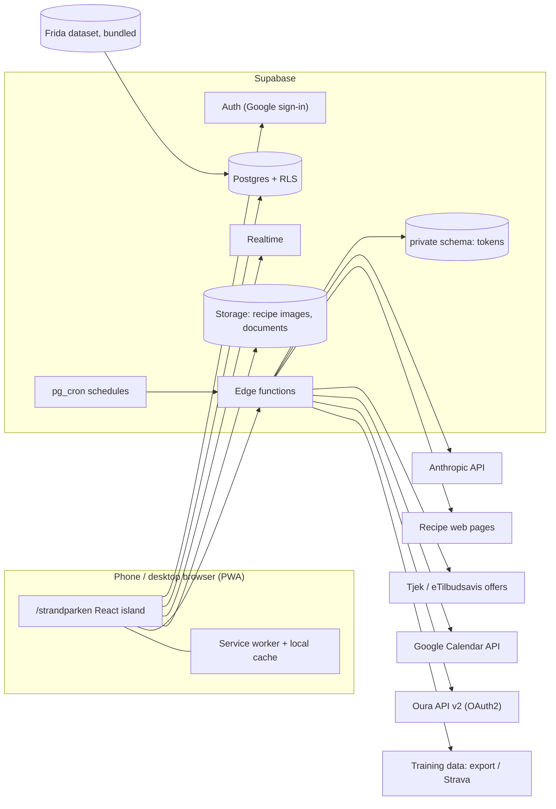
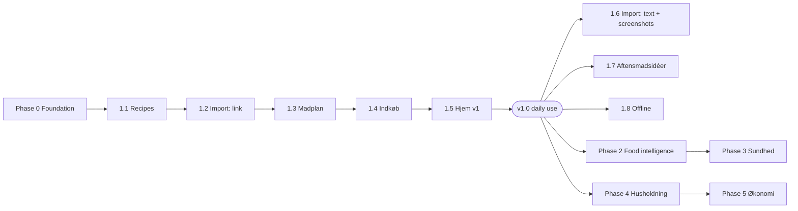

# Strandparken — Household App Design

**Status:** Requirements optimised. Ready for ADRs and implementation plans.
**Version:** 2.1 (2026-11-12) — supersedes the requirements draft of 2026-11-11. Changes since 2.0 are listed in §0.1.
**Companion:** `docs/superpowers/specs/2026-11-12-strandparken-ui-design.md` is the visual source of truth (D56).
**Route:** `https://jonasjlc.github.io/strandparken/`
**Suggested repo path:** `docs/superpowers/specs/2026-11-11-strandparken-design.md` (follows the existing `docs/superpowers/specs/` convention)
**Spec language:** English. **UI copy:** Danish.

How to read this document: §3 is the decisions log. Decisions D1–D26 were agreed during requirements gathering. Decisions D27–D54 were taken while optimising the plan, without consultation; each is a reversible default and is marked **Default**. Three agreed decisions were changed because desk research showed they could not be built as written; they are marked **Amended** and explained in §7.1.

---

## 0. What changed from the draft

| # | Change | Why |
|---|---|---|
| 1 | Six of the eight risks researched at the desk (R1–R6). R2 is closed outright; three agreed decisions are amended (D4, D7, D14) and D13 is tightened. | The draft planned features on sources that are closed, paywalled by review, or do not carry the data. See §7.1. |
| 2 | All 15 open questions closed with defaults (D27–D54). Four questions remain that only Jonas and Camilla can answer (§11). | No feature plan is blocked by a "TBD". |
| 3 | Delivery reordered: the app is usable (milestone **v1.0**) after six slices. Import → plan → list comes before the secondary import paths and the idea catalog. | Earliest possible daily use; real usage then steers the rest. |
| 4 | Shopping items are stored per source and merged on display (D36). | Regenerating the list after a plan change becomes safe and repeatable; removing a day removes exactly its items. |
| 5 | Allergies are enforced by code, before and after any AI call (§5.3.5). | An acceptance criterion that says "never" cannot rest on a language model. |
| 6 | Per-person portions defined as a share of the dish plus grams (D42, §5.4.3). | "Portion in grams" was not computable as written: it needs a cooked weight and a rule for when two portions do not add up to the pot. |
| 7 | Access model made explicit: person-level rules for profiles, goals and health data; health sharing is a revocable consent (D40, §2). | "Household RLS" alone would let either person edit the other's goal, and would make Camilla's cycle data visible without a recorded choice. |
| 8 | Security section added: URL-fetch hardening, untrusted page content, token rotation, AI budget cap (§4.5). | `recipe-import` fetches arbitrary URLs and feeds them to a model. |
| 9 | Non-functional requirements, test strategy, definition of done and phase exit criteria added (§4.6, §9). | The draft had acceptance criteria per feature but nothing that says when a phase is finished. |
| 10 | "Cooked" defined (D35); `times_cooked` is derived, not stored. | D21 (learning from what is cooked often) had no data behind it. |
| 11 | UI copy: `Lav denne` → `Læg på indkøbslisten`; `Ny forslag` → `Nyt forslag` (D50). | The first label reads as "start cooking"; the second was a grammar error. |
| 12 | Privacy flag: confirm repo visibility before committing this spec (C6). | A public `github.io` repo would publish that the app handles Camilla's cycle data. |

### 0.1 Changes in version 2.1

| # | Change | Why |
|---|---|---|
| 1 | Visual direction chosen: mockup A (Fotoforrest) with the flat bottom bar from mockup B (D56). §5.2 points to the UI spec. | Decision by Jonas after testing the three mockups. |
| 2 | Allergies removed from scope (D55): no allergen tags, no allergen filter. Dislikes remain. | Neither person has allergies. Row 5 above no longer applies. |
| 3 | Health sharing and the period-log fallback are confirmed by Camilla (D39, D40). | Answer to §11. |
| 4 | §11 reduced to one open point. | Three of four questions answered. |

---

## 1. Purpose

Strandparken is a private household app for Jonas and Camilla. Its core is food: saving recipes from anywhere, planning the week's dinners, and producing one clean shopping list that shows where the list's items are on offer. Around that core sit health (Camilla's Oura, Jonas's training data, macros and personal weight goals), household management (tasks, habits, a wishlist for the home) and a light finance area (subscriptions, stored receipts).

Design principle: **clean, photo-led and calm.** Every screen should be scannable in a few seconds on a phone.

### 1.1 Goals

- **G1** Any recipe found online, on Instagram or in a screenshot becomes a structured, editable recipe inside the app. The source link is kept only as a reference.
- **G2** The week's dinner plan is visible at a glance and fills itself on request, one day at a time.
- **G3** One shared shopping list, grouped by category, built from the plan and from single items, with an overview of current offers across Netto, Føtex, Rema 1000 and Lidl.
- **G4** Each person can opt into a weight goal and see their own portion of any recipe.
- **G5** Household chores and habits are visible on the home screen and can be claimed by either person.

### 1.2 Success measures

| Measure | Target |
|---|---|
| Recipe import from a page with structured data, link pasted to draft shown | ≤ 10 s |
| From a planned week to a finished shopping list | ≤ 3 taps plus the "har hjemme" review |
| A tick on one phone visible on the other | ≤ 3 s online |
| Tonight's dinner visible after opening the app | Without scrolling, ≤ 2 s on 4G |
| Running cost | Supabase free tier; AI ≤ 50 kr./month (D48) |

### 1.3 Non-goals (v1)

- No users beyond Jonas and Camilla; no guest access; no building or neighbour features (the polet app stays separate).
- No breakfast or lunch planning. Dinner only.
- No push notifications, e-mail or SMS. Reminders are in-app badges only.
- No two-way Google Calendar sync. The app writes the dinner plan to the calendar only.
- No full pantry inventory. "Already have it" is decided per addition to the list.
- No cooking mode with timers or screen wake lock (a simple step-by-step guide only).
- No bank integration or automatic subscription detection.
- No total basket price and no savings in kroner. Offer data does not contain shelf prices (§7.1, R1).
- No dark mode, no desktop sidebar (D28, D29).
- No AI-invented dishes (D34).

### 1.4 Constraints

- **C1** Static hosting on GitHub Pages. Everything that needs a secret or a server callback runs in a Supabase edge function.
- **C2** One shared Supabase project with `/ferie`. New objects carry the `sp_` prefix (D27).
- **C3** Free-tier budgets: Supabase database, storage and function limits; images are compressed before upload (§4.6).
- **C4** Phones first. Both people use the app as an installed PWA; iOS PWAs have no share target and handle OAuth redirects differently from a browser tab, so sign-in and install are verified on both phones in Phase 0.
- **C5** Health, cycle and body data are sensitive. They stay behind row-level security, never appear in logs, and are sent to an AI model only when a function cannot work without them (§4.5).
- **C6** The repository may be public. Confirm visibility before committing this spec; if it is public, keep this document and the health ADRs out of it or make the repo private.
- **C7** Third-party terms are binding even for a two-person app: Tjek (offers), Oura, Google, Meta and Strava terms decide what may be fetched, stored, shown to the other person, and sent to a model.

---

## 2. Users and access

| Person | Role in the app | Integrations |
|---|---|---|
| Jonas | Full member, owner (`is_owner`) | Training data (§5.4.4), Google Calendar (owner of the Madplan calendar) |
| Camilla | Full member | Oura |

The app reuses the `/ferie` people (person key `a` = Camilla, `b` = Jonas) and avatars (`public/ferie/avatars/`). A person key maps to exactly one `auth.users` id through `household_members`.

### 2.1 Who can see and change what

| Data | Read | Write |
|---|---|---|
| Recipes, ideas, madplan, shopping list, tasks, shared habits, wishlist, subscriptions, documents, household settings | Both | Both |
| Personal habits | Both (the other person's behind a toggle) | Owner |
| Profile: dislikes, preferences | Both (needed for suggestions) | Owner |
| Body data, weight log, goal | Owner; the other person sees only the resulting portion on recipes | Owner |
| Oura and training data | Owner; the other person only while the owner's `Del med …` switch is on (D40) | Sync functions only |
| Integration tokens | Edge functions only | Edge functions only |

Acceptance criteria:
- [ ] A signed-in person who is not a member of the household sees no data at all.
- [ ] Neither person can change the other's profile, body data or goal, including through the API.
- [ ] Turning off health sharing removes the other person's access immediately, including to history.

---

## 3. Decisions log

**ADR** marks a decision that needs its own architecture decision record before build (§10).

### 3.1 Agreed during requirements gathering

| # | Topic | Decision |
|---|---|---|
| D1 | Tech foundation | Reuse the `/ferie` stack: Astro page + React island, Tailwind, shadcn/ui, Supabase, Google sign-in, the same household and invite model. **ADR-01** |
| D2 | Users | Only Jonas and Camilla. |
| D3 | Priority | 1) Opskrifter + Madplan + Indkøb, 2) Sundhed, 3) Husholdning, 4) Økonomi. |
| D4 | Recipe import | **Amended.** URL to a web page; pasted text; screenshot upload read by AI. A pasted Instagram/TikTok link is stored as the source reference, and the content comes from pasted text or a screenshot in the same step. Captions are not fetched server-side (R2). |
| D5 | Dinner catalog | One visual catalog containing dinner recipes and free-text dinner ideas. Shown as a segment in Opskrifter **and** as a picker in Madplan. |
| D6 | Supermarkets | Netto, Føtex, Rema 1000, Lidl. |
| D7 | "Cheapest" | **Amended.** Three views are kept: one store, at most two stores, best per item. They rank on **current weekly offers**, because shelf prices are not available for these chains. No basket total, no savings in kroner (R1). |
| D8 | Already at home | Untick items in a review each time ingredients are added. No stored pantry. |
| D9 | List grouping | By grocery category, in store-walk order (D31). |
| D10 | Madplan scope | Dinner only. |
| D11 | Google Calendar | Write the madplan into the calendar (one-way). Details in D37. **ADR-03** |
| D12 | AI suggestions | Suggest per empty day (no whole-week generation, no automatic drafts). |
| D13 | Oura | Camilla's readiness and cycle day, with an explanation aimed at Jonas. Lives in the Sundhed tab only. Tightened by D38–D40. |
| D14 | Training data (Garmin) | **Amended.** No automated Garmin integration in v1: the official programme is closed to new applicants and the community libraries stopped working in 2026 (R4). Path in D52. **ADR-06** |
| D15 | Portions with a goal | Per-person portion shown on the recipe. Defined in D42. |
| D16 | Nutrition data | Hybrid: Danish food database (Frida) first, AI estimate as fallback. **ADR-04** |
| D17 | Habits | Personal and shared habits, with a per-person view. |
| D18 | Household tasks | One-off and recurring, with due dates; reminders as in-app badges only. |
| D19 | Praktiske indkøb | Wishlist of things to buy for the home; lives in Husholdning (not in Indkøb). |
| D20 | Subscriptions | Manual list: name, price, billing cycle, renewal date. |
| D21 | Learning | From the profile (dislikes, preferences) and implicitly from what is saved and cooked often (D35). No ratings. |
| D22 | Recipe page extras | Edit imported recipe, keep original source link, step-by-step guide. |
| D23 | Home screen | Today's dinner + this week; today's tasks + habits; links to Husholdning and Økonomi. |
| D24 | Navigation | Bottom bar: **Hjem · Madplan · Indkøb · Sundhed · Opskrifter**. |
| D25 | Categories | One fixed (editable) category per recipe, plus free tags. |
| D26 | Visual identity | Its own identity, derived from the reference images, not the `/ferie` tokens. |

### 3.2 Defaults taken while optimising the plan

Each of these replaces a "TBD" in the draft. All are reversible; veto any of them before the feature plan that depends on it.

| # | Topic | Decision (Default) | Reason |
|---|---|---|---|
| D27 | Data storage | Relational tables, one per entity, prefix `sp_`, in the shared Supabase project's `public` schema. **ADR-02** | `/ferie`'s single `jsonb` blob (1 MB cap) cannot hold images, logs and offers or answer queries. A prefix needs no extra API schema configuration. |
| D28 | Desktop layout | The phone layout centred in a column (max 520 px; the recipe grid may widen to 960 px). The bottom bar stays. No sidebar. | Nearly all use is on phones. One layout halves the design-system work. |
| D29 | Dark mode | Not in v1. All colours are CSS variables so it can be added later. | The identity is light and photo-led; a second palette doubles contrast testing. |
| D30 | Recipe categories | Aftensmad · Tilbehør & salat · Frokost · Morgenmad & brunch · Bagværk · Sødt · Snacks & dip · Drikke. Editable. | Covers the notes (Aftensmad, Sødt, Bagværk) and keeps "Aftensmad" clean for the catalog. |
| D31 | Grocery categories | Frugt & grønt · Brød & bagværk · Kød & fisk · Pålæg & køl · Mejeri & æg · Frost · Kolonial · Konserves & glas · Krydderier, olie & bagning · Drikkevarer · Snacks & slik · Husholdning & pleje · Andet. Editable and reorderable. | Follows a typical walk through a Danish supermarket, so the list reads top to bottom in the store. |
| D32 | Normalisation on import | Every imported recipe is rewritten to Danish and metric units (g, kg, ml, dl, l, tsk, spsk, stk, fed, bundt, dåse), and each ingredient gets a canonical name and a grocery category. The original text is kept alongside. | Merging, categories and nutrition all depend on it. American cups and ounces are useless in a Danish kitchen. |
| D33 | Idea → recipe | A free-text idea can be turned into a recipe (`Lav til opskrift`); madplan entries that pointed at the idea follow. | Ideas are where recipes start. |
| D34 | AI suggestion scope | Suggestions come only from the household's own recipes and ideas. | Keeps suggestions cookable. Inventing dishes can be added later as a separate button. |
| D35 | "Cooked" | A recipe counts as cooked once for each madplan entry whose date has passed. No "mark as cooked" step. | Zero extra taps; removing a day that did not happen corrects it. |
| D36 | Shopping list model | One continuous list. Items are stored one row per source (plan entry, recipe or manual) and merged on display. Generating from the plan is repeatable. **ADR-08** | See §5.3.4. |
| D37 | Google Calendar details | A dedicated secondary calendar "Madplan", created by the app in Jonas's Google account and shared with Camilla. One timed event per dinner, default 18:00–19:00 (configurable), marked as free time. Title = dish name; description = link to the recipe. Scope limited to calendars the app created; the OAuth consent screen is published to production. | A dedicated calendar keeps private calendars untouched, and deleting it removes every event. A testing-status consent screen expires refresh tokens after seven days (R6). |
| D38 | Oura explanation | Curated Danish text per cycle phase and readiness band, written once and reviewed by Camilla. No Oura data is sent to an AI model. | Predictable, free, private, and avoids Oura's restrictions on AI processing of API data (R3). |
| D39 | Cycle day source | From the Oura API if Camilla's account exposes it; otherwise Camilla logs the first day of her period in the app (one tap) and the app counts from there. Confirmed by Camilla. | Public endpoint lists show no cycle endpoint (R3). The fallback keeps the feature. |
| D40 | Health sharing | Each person has a `Del med …` switch per integration, off by default, revocable at any time. Camilla has agreed to share readiness and cycle day. | Consent is a recorded choice, not an assumption. |
| D41 | Goals | Three types: `Tag på (muskelmasse)`, `Tab dig`, `Hold vægten`. Body data: weight, height, birth year, sex, activity level (four steps). Weight is logged manually. | "Hold vægten" gives a personal portion without a weight change. A separate "gain weight" type adds nothing. |
| D42 | Portion model | Each person's portion is a share of the cooked dish, shown as grams and percent (§5.4.3). | The only definition that stays correct when two portions do not add up to the pot. |
| D43 | Micronutrients | Kostfibre, jern, calcium, D-vitamin, C-vitamin, folat, B12. Shown as share of the daily reference value. | Small enough to scan on a phone. Adjust the set once Frida coverage is known (R5). |
| D44 | Supplements | Suggestions come only from a short curated list that mirrors official Danish recommendations, with the source named. No AI-generated supplement advice, no doses beyond the official text. | Removes the largest health-guidance risk (R8). |
| D45 | Habits | Frequency is daily or N times per week. The app shows this week's progress and a four-week history. No streak mechanics. | Enough to see the pattern without turning the home into a game. |
| D46 | Task recurrence | Every N days, weeks or months. The next due date counts from completion by default; `Fast dato` keeps a fixed schedule. | Chores done late should not be due again two days later; bills should. |
| D47 | Offline | Indkøb works fully offline (read, tick, add); changes sync when the connection returns. Other tabs show the last loaded data read-only with an offline note. **ADR-09** | Supermarkets have poor signal. Everything else can wait. |
| D48 | AI models and budget | Small model by default (the repo default `claude-haiku-5-5`); a stronger model only for screenshot reading and nutrition recommendations. Every call is logged; a hard cap of 50 kr./month stops AI features with a clear message. **ADR-07** | Cost stays bounded without anyone watching it. |
| D49 | Forslag | Reuse the `/ferie` Forslag component, opened from settings. | Gives Camilla a way to ask for changes without GitHub. |
| D50 | UI copy | `Læg på indkøbslisten` (was `Lav denne`); `Nyt forslag` (was `Ny forslag`). | Clarity and grammar. |
| D51 | Offers source | Weekly offers from the Tjek / eTilbudsavis platform, which carries all four chains, subject to a terms check. Fallback: each list line links to an eTilbudsavis search, and nothing is stored. **ADR-05** | The only source found that covers Rema 1000 and Lidl as well (R1). |
| D52 | Training data path | In order: (1) reuse the existing `garmin-dashboard/` export if it still produces JSON; (2) Strava activities, visible to Jonas only; (3) manual weekly entry. Revisit when Garmin reopens its developer programme. | Keeps the Sundhed tab useful without depending on a closed API. |
| D53 | Time | All dates are computed in `Europe/Copenhagen`. Weeks are ISO weeks, Monday first. | "Today" and "this week" must agree on both phones and on the server. |
| D54 | Deleting recipes | Recipes are archived, not deleted. Past madplan entries keep their dish. | History and "cooked often" stay intact. |
| D55 | Allergies | Out of scope. The profile holds dislikes and preferences only; there are no allergen tags and no allergen filter. | Neither person has allergies. If that changes, add allergen tags per ingredient and a code-level filter before any AI suggestion. |
| D56 | Visual direction | Mockup A (Fotoforrest): photo-led white cards on warm off-white, Fraunces titles, Figtree body, deep green actions. The bottom bar is the flat bar from mockup B: five equal items, no raised or emphasised item. Details in the UI spec. | Chosen by Jonas after testing the three mockups. |

---

## 4. Architecture

### 4.1 Context

### 4.2 Reused from `/ferie`

- Astro page at `src/pages/strandparken/index.astro`, React code in `src/components/strandparken/`, styles in `src/styles/strandparken.css`. Unlisted (`noindex, nofollow`), not linked from the homepage.
- Supabase project, `households`, `household_members`, the invite flow and the verified-email claim trigger.
- `AuthGate` and the Google sign-in pattern, extracted into a shared module so both apps keep one sign-in implementation (slice 0.2).
- Edge-function pattern for Anthropic calls: secret in `ANTHROPIC_API_KEY`, model from a per-function env var with a default.
- Hash-based view routing (`#hjem`, `#madplan`, …), so a refresh or shared link opens the same screen. Sign-in must use the PKCE flow (`?code=`), so the auth response never collides with the view hash.
- CI: extend `.github/workflows/pages.yml` to also verify `dist/strandparken/index.html`. Update `AGENTS.md` so the React/Tailwind/Supabase exception covers `/strandparken/` too.

### 4.3 New in `/strandparken`

- **Relational tables** (D27), all keyed by `household_id`, with the same policy shape as `ferie_state` plus person-level policies where §2.1 requires them.
- **Supabase Storage**, two private buckets (`sp-recipes`, `sp-documents`), read through short-lived signed URLs.
- **Realtime** on the shopping list (the `forslag` channel is the existing precedent).
- **Integration tokens** stored server-side in the `private` schema, encrypted; only edge functions read them.
- **Scheduled jobs** through `pg_cron` calling edge functions (offers, Oura, training data).
- **Own PWA manifest**, icon set and service worker under `public/strandparken/`, scope `/strandparken/`, app name "Strandparken".
- **Frida** food data loaded into a reference table by a one-off script (after R5).

### 4.4 Edge functions

Every function verifies the caller's JWT and household membership, validates its input against a schema, enforces a per-person daily rate limit, and writes one row to `sp_ai_usage` per model call.

| Function | Trigger | Purpose |
|---|---|---|
| `recipe-import` | User | URL → fetch page → parse schema.org `Recipe` JSON-LD if present → normalise (D32). Also accepts pasted text and screenshot images. Returns a structured draft; saves nothing. |
| `meal-suggest` | User | One dinner for a given empty day, chosen from candidates that the function has already filtered in code (§5.3.5). |
| `nutrition` | On recipe save | Resolves ingredients to Frida, AI estimate for misses; stores macros and micros per serving with a source flag; produces recommendations. |
| `offers-sync` | Daily schedule | Pulls current offers for the active chains near the household into `sp_offers`; matches them to list lines on request. |
| `calendar-oauth` | User | Handles the Google authorisation code flow for the calendar scope and stores the refresh token. |
| `calendar-write` | Madplan change | Creates, updates and deletes events in the Madplan calendar. Failed writes are queued and retried. |
| `oura-oauth` / `oura-sync` | User / daily schedule | OAuth2 for Camilla's account; daily pull of readiness (and cycle data if available). |
| `training-sync` | Schedule or upload | Per D52, after R4. |

### 4.5 Security and privacy

- **Fetching arbitrary URLs (`recipe-import`).** HTTPS only; private, loopback and link-local addresses are refused, also after redirects; at most three redirects, an 8-second timeout and a 2 MB body; no cookies or credentials are sent.
- **Untrusted content.** Web pages, captions and screenshots are data, never instructions. Model calls that read them have no tools, must return JSON matching a schema, and produce only a draft that a person reviews before it is saved.
- **Allergies.** Out of scope (D55).
- **Health data.** Body data and targets are computed in code. Cycle and readiness data are never sent to a model (D38). Dislikes and preferences may be sent to `meal-suggest`.
- **Tokens.** Stored encrypted in `private.sp_integration_tokens`. Oura refresh tokens are single-use: a refresh stores the new token in the same transaction and is serialised with an advisory lock, so two runs cannot invalidate each other.
- **Images.** Recipe photos are copied into Storage for private use; they are never served publicly.
- **Logs.** No health data, tokens or page bodies in function logs.
- **Budget.** `sp_ai_usage` records tokens and estimated cost; the shared helper refuses calls above the monthly cap (D48).
- **Export and deletion.** A household export (JSON plus images) is available from settings. Disconnecting an integration deletes its tokens and, on request, its stored data.

### 4.6 Non-functional requirements

| Area | Requirement |
|---|---|
| Performance | First load of the app shell ≤ 200 kB JavaScript gzipped. List and grid images are served at display size (thumbnails ≤ 40 kB). |
| Images | Compressed in the browser before upload: longest edge 1600 px, WebP, ≤ 300 kB. A thumbnail is generated at the same time. |
| Accessibility | WCAG AA contrast; touch targets ≥ 44 px; all actions reachable by keyboard; reduced motion respected. |
| Resilience | Every external integration can fail without breaking the core: madplan and shopping work with offers, calendar, Oura and AI all down. |
| Freshness | Every card that shows synced data shows when it was last updated and never presents stale data as today's. |
| Observability | Edge functions log outcome, duration and cost per call. A simple status sheet in settings shows last sync time and last error per integration. |
| Browser support | Current Safari on iOS and current Chrome on Android, installed as a PWA; current desktop Chrome and Safari. |

### 4.7 AI usage principles

1. Deterministic code first: scaling, merging, targets, portions and recurrence never involve a model.
2. A model call always returns structured data validated against a schema; invalid output is retried once and then reported.
3. Every AI result that a person will rely on is shown as a draft or labelled as an estimate.
4. Prompts live in the repository next to their function, with a small golden test set (§9.2).

---

## 5. Functional specification

Each module lists requirements, UI and acceptance criteria. Acceptance criteria describe conditions, not solutions.

### 5.1 App shell

**Navigation:** bottom bar with five tabs in this order: Hjem, Madplan, Indkøb, Sundhed, Opskrifter. Husholdning and Økonomi are full pages opened from Hjem, with a back arrow. The same layout is used on desktop, centred (D28).
**Header:** avatar of the signed-in person; opens settings (profile, goals, integrations and sharing, categories, export, Forslag, sign out).
**Feedback:** every action that changes data confirms itself in place (the row changes) or with a short toast that offers `Fortryd` for destructive actions.
**States:** every list and card has a designed empty state, loading state and error state.

Acceptance criteria:
- [ ] Every tab can be reached in one tap on a phone.
- [ ] Refreshing the page keeps the current view.
- [ ] Only signed-in members of the household can see any data.
- [ ] The app can be installed to the home screen with its own name and icon.
- [ ] Sign-in works inside the installed app on both phones.
- [ ] Removing or clearing something by mistake can be undone for a few seconds.

### 5.2 Visual design

Its own identity, taken from the reference images:

| Reference | What to take from it |
|---|---|
| Alfredo Pasta detail (img 1/5) | Large hero photo with the content sheet overlapping it; serif display title; small descriptor line; pill-shaped −/+ stepper; one stat row split by thin rules; deep green primary button. Not taken: the emphasised centre item in the bottom bar (D56). |
| Cacao Maca recipe app (img 2) | Very light, quiet layout; tab strip for Ingredienser / Fremgangsmåde; a persons stepper with an icon between − and +; meta row with time and portions. |
| Julienne / Cookbook (img 3) | Serif headings; list rows with round dish photos; category chips; recipes and shopping list as two tabs of one area. |
| Grid (img 4) | Photo-first cards in a grid with category labels, so a category is scannable by image. |

Design tokens (direction chosen in D56; exact values, components and screen anatomy are in the UI spec, which wins over this list where they differ):
- Background: warm off-white; cards: white with a soft shadow; rounded corners (≈20 px cards, pill controls).
- Primary: deep green for primary actions, active navigation and steppers.
- Typography: a serif display face for titles, a clean sans for body. Fonts are self-hosted, as on the rest of the site.
- Photography carries colour; UI chrome stays neutral.
- Each person has a stable colour and their avatar on everything they own or claimed.
- Bottom bar: flat, five equal items with icon and label, the active item marked by colour and a thin top indicator. No raised or emphasised item.
- Light theme only (D29).

Acceptance criteria:
- [ ] A recipe list is scannable by photo without reading titles.
- [ ] The portion stepper looks and works the same everywhere it appears.
- [ ] All text meets WCAG AA contrast against its background.
- [ ] Items without a photo look intentional, not broken.

### 5.3 Food

#### 5.3.1 Opskrifter (tab)

**Segments:** `Alle` · `Aftensmadsidéer`.

**Browse:** photo grid, category chips (D30), tag filter, free-text search over title, tags and ingredient names.

**Categories:** one fixed category per recipe from an editable set (D30). Free tags can be added on top (e.g. "hurtig", "vegetar", "meal prep").

**Import** (`Tilføj opskrift`), three entry points plus manual:
1. **Link** — paste any link. A web page is fetched, structured `Recipe` data is preferred, AI is the fallback. An Instagram or TikTok link is recognised, stored as the source, and the sheet asks for the caption text or a screenshot straight away (D4).
2. **Indsæt tekst** — a pasted caption or any text.
3. **Upload skærmbilleder** — one or more images, read by AI.
4. **Skriv selv** — an empty editor.

Import always ends on an **editable draft** for review before saving. Fields the importer was unsure about are marked. Importing a link that already exists in the collection warns and offers to open the existing recipe.

**Recipe fields:** title, photo (copied into Storage; replaceable), short descriptor, category, tags, base servings, total time, ingredients (amount, unit, name, canonical name, grocery category, optional note, `scales` flag), steps (ordered), source URL (reference only), original text, nutrition per serving (computed, §5.4.2), created by, created at, archived at.

**Scaling rules:** amounts scale linearly with persons; results are rounded to kitchen-friendly values (whole eggs, 5 g steps, quarter spoons); ingredients flagged as not scaling ("salt efter smag") stay as written.

**Recipe detail page:**
- Hero photo, title, descriptor, stat row (time, servings, kcal per serving once nutrition exists; the row hides kcal until then).
- Persons stepper that scales all ingredient amounts.
- Tabs: `Ingredienser` · `Fremgangsmåde` · `Næring` (the last from Phase 3).
- Fremgangsmåde is a step-by-step guide: numbered steps with ingredient amounts inline where possible.
- When a person has an active goal: that person's portion (§5.4.3).
- Actions: `Læg på indkøbslisten` (through the "har hjemme" review, §5.3.4), `Tilføj til madplan` (pick a day), `Rediger`, `Se original`, `Arkivér`.

Acceptance criteria:
- [ ] A recipe from a page with structured recipe data imports with title, photo, servings, ingredients and steps without manual edits.
- [ ] A recipe from pasted text or screenshots can be imported, reviewed and saved.
- [ ] Pasting a social-media link leads directly to a way to continue with text or a screenshot.
- [ ] An imported recipe is in Danish with metric units, and the original wording can still be seen.
- [ ] A saved recipe works fully if the source page disappears.
- [ ] Every field of an imported recipe can be edited.
- [ ] Changing the number of persons updates every scaling ingredient amount to a kitchen-friendly value.
- [ ] Each recipe has exactly one category and zero or more tags.
- [ ] Recipes can be found by category, tag, title and ingredient.
- [ ] Importing the same link twice does not silently create a duplicate.

#### 5.3.2 Aftensmadsidéer (catalog)

One visual catalog of all dinner options: every recipe in category Aftensmad **plus** free-text ideas (title, optional photo, optional note, optional tags). It solves "we have run out of inspiration".

Shown in two places:
- As the `Aftensmadsidéer` segment in Opskrifter (browse and add ideas).
- As the picker in Madplan (§5.3.3).

Acceptance criteria:
- [ ] A dinner idea can be added with only a title.
- [ ] Recipes and free-text ideas appear together in one scannable catalog and are visually distinguishable.
- [ ] Ideas without a photo still look intentional.
- [ ] An idea can be turned into a recipe without losing the days it was planned on.

#### 5.3.3 Madplan (tab)

**Scope:** dinner only, one entry per day.

**Layout:** a week header with week number and ‹ › to move between weeks, then seven compact day rows (Man–Søn). A planned day shows a round dish photo (or an initial tile for free text), title, time and number of persons. Today's row is highlighted. An empty day shows a dashed row with `Tilføj ret`.

**Filling a day** — tapping an empty day opens a sheet with:
1. `Søg i opskrifter`
2. `Fra aftensmadsidéer` (the catalog, §5.3.2)
3. `Skriv selv` (free text, no recipe), with one-tap chips for the common non-recipes: `Rester`, `Ude at spise`, `Takeaway`
4. `Foreslå ret` (AI suggestion for this day, §5.3.5)

**Per day:** persons stepper (default 2), move or swap with another day, remove, open recipe.

**Week actions:** `Lav indkøbsliste` (§5.3.4). The calendar write is automatic once connected (§5.3.6).

Acceptance criteria:
- [ ] The whole week is readable on one phone screen without opening anything.
- [ ] A day can hold either a recipe, an idea or free text.
- [ ] A dish can be moved to another day, and two days can be swapped.
- [ ] Persons per day changes the amounts sent to the shopping list.
- [ ] Past and future weeks can be viewed.
- [ ] The week shown as "this week" is the same on both phones at any time of day.

#### 5.3.4 Indkøb (tab)

**One shared, continuous list** for the household, grouped by grocery category in store-walk order (D31).

**Sources of items:**
- `Lav indkøbsliste` from the week's madplan.
- `Læg på indkøbslisten` from a single recipe.
- Single items added by hand (`Tilføj vare`), not tied to any recipe or plan. The category is guessed from the name and can be changed.

**"Har hjemme" review:** before recipe ingredients join the list, a review sheet shows them all checked; the user unticks what they already have. Nothing is remembered as a pantry (D8). The choice is remembered only for that plan entry, so generating the list again does not ask twice.

**Storage and merging (D36):** each ingredient is stored as its own row with its source (plan entry, recipe or manual). The list shows rows with the same canonical name and compatible unit as one line with a summed amount, and names the dishes it comes from. Amounts in incompatible units (g and stk) stay as separate lines. Ticking a merged line ticks all its rows.

**Generating from the plan is repeatable:** running `Lav indkøbsliste` again adds ingredients for new days (through the review), removes unticked ingredients of days that were removed, and updates amounts where persons changed. Ticked items are never touched.

**While shopping:** tick items off; ticked items collapse to the bottom; both people see ticks live. `Ryd afkrydsede` clears bought items and can be undone. The list works offline (D47); when two phones change the same item, the latest change wins.

**Tilbudsoverblik** (offers, D7 amended) — a sheet with three views, all based on this week's offers:
1. **Én butik** — the chain where most of the list is on offer ("8 af 23 varer på tilbud"); ties go to the lower sum of offer prices.
2. **Maks 2 butikker** — the pair of chains that covers most of the list, with which items to buy where.
3. **Bedst pr. vare** — for each item, the chain with the lowest unit price (kr./kg, kr./l or kr./stk) and the date the offer ends.

Every view states how many items have no offer, marks uncertain matches as such, and shows when offers were last updated. No basket total and no savings figure are shown, because neither can be computed honestly from offer data.

Acceptance criteria:
- [ ] Generating a list from the madplan puts each ingredient under its correct category.
- [ ] Items the user unticked in the review do not appear on the list, and are not asked about again for the same day.
- [ ] A single item can be added in two taps or fewer.
- [ ] The same ingredient from several recipes appears once with a combined amount and names its dishes.
- [ ] Generating the list twice in a row changes nothing.
- [ ] Removing a day from the madplan and generating again removes that day's unticked ingredients only.
- [ ] A tick on one phone appears on the other within a few seconds.
- [ ] The list can be read, ticked and added to without a connection, and the changes appear on the other phone once the connection returns.
- [ ] All three offer views are available, state which items have no offer, and show when the data was last updated.
- [ ] An offer that has ended is never shown as current.

#### 5.3.5 AI dinner suggestions

Triggered **per empty day** only (`Foreslå ret`). Returns one suggestion with a short reason, plus `Nyt forslag` for another.

**How a suggestion is made:**
1. Code builds the candidate list: all recipes in Aftensmad and all ideas, minus dishes already planned this week, minus dishes cooked in the last 14 days.
2. The model ranks the candidates and writes the reason, using: dislikes and preferences, how often dishes are cooked and what was saved recently, the rest of the week (variety), and the household principles **easy** and **plenty of vegetables**.
3. Code checks that the answer is one of the candidates; anything else is discarded.

Ideas have no ingredient list, so an idea can only be checked against dislikes by its title and tags; it is offered with the note "idé – tjek ingredienser".

Acceptance criteria:
- [ ] A suggestion avoids dislikes unless there is no alternative, and says so.
- [ ] The same dish is not suggested twice in the same week.
- [ ] Every suggestion comes with a one-line reason.
- [ ] When no candidate is left, the app says why and points to adding recipes.

#### 5.3.6 Google Calendar (write-only)

The madplan is written to a dedicated Google calendar "Madplan" (D37). Jonas connects once from settings; the app creates the calendar and shares it with Camilla. Each dinner is one timed event, marked as free time, with the dish as the title and a link to the recipe in the description.

Acceptance criteria:
- [ ] Adding, changing, moving or removing a dinner in the madplan is reflected in the calendar.
- [ ] A calendar outage never blocks a madplan change; the calendar catches up afterwards.
- [ ] The connection keeps working for months without anyone signing in again.
- [ ] Disconnecting offers to delete the Madplan calendar, which leaves no events behind.
- [ ] No event is ever created in a personal calendar.

### 5.4 Sundhed (tab)

Sections, top to bottom: Camilla's Oura card, Jonas's training card, personal goals, nutrition insights. Each person sees their own cards always, and the other's only while sharing is on (D40).

#### 5.4.1 Oura (Camilla)

- Today's **readiness** score.
- Today's **cycle day** and phase (D39).
- A short **explanation written for Jonas**: what today's phase and readiness band may mean in practice, from the curated texts (D38).
- Camilla authorises the connection with her own Oura account and decides whether Jonas sees the card.

Acceptance criteria:
- [ ] Today's readiness and cycle day are shown when there is data for today.
- [ ] When data is missing or stale, the card says so rather than showing old values as today's.
- [ ] The explanation is understandable without prior knowledge of the cycle phases.
- [ ] Camilla has read and approved every explanation text before Jonas can see any.
- [ ] Camilla can stop sharing or disconnect Oura at any time, and Jonas's view disappears at once.

#### 5.4.2 Nutrition and macros

- Every recipe gets macros (protein, carbohydrate, fat, kcal) and the micronutrients in D43 per serving.
- Source: Frida per ingredient first; AI estimate when an ingredient cannot be matched. Each value is labelled as database or estimate, and the recipe shows the share of its energy that rests on estimates.
- Ingredient amounts given by the piece ("1 løg") are converted to grams with standard piece weights.
- **Recommendations** are concrete additions, for example "Tilføj edamamebønner — retten mangler protein" or "Tilføj appelsin i salaten for mere C-vitamin". They show on the recipe's `Næring` tab and on the madplan day. At most two per recipe.
- **Supplement suggestions** follow D44.

Acceptance criteria:
- [ ] Every saved recipe shows macros per serving.
- [ ] Estimated values are visibly marked as estimates.
- [ ] A recommendation always names a specific food and the reason.
- [ ] Recommendations respect dislikes.
- [ ] A supplement suggestion always names its official source and is worded as a suggestion.

#### 5.4.3 Personal goals

- Opt-in **per person**. Either Jonas, Camilla, both or neither can have a goal.
- Goal types (D41): `Tag på (muskelmasse)`, `Tab dig`, `Hold vægten`.
- Inputs: amount (kg) and target date, plus body data (D41). Weight is updated by hand; the Sundhed tab shows a quiet prompt when the last entry is more than a week old.
- Output: a daily energy and protein target, calculated in code from a published resting-energy equation and the activity level, and a **personal portion** on every recipe.

**Portion model (D42):**
- The scaled recipe has a total energy and an estimated cooked weight (ingredient weights adjusted by standard yield factors; labelled approximate).
- Each person has a dinner budget: daily energy target × dinner share (default 35 %, adjustable 25–45 %). A person without a goal gets a standard portion: the dish divided by the number of persons.
- A person's portion is their budget as a share of the dish, shown as grams and percent: "Jonas 480 g (58 %)".
- When the portions add up to more than the dish, the recipe suggests cooking more ("Skalér til 2,5 portioner"). When they add up to less, it shows what is left over.

**Guardrails (defaults, confirmed in R8 before build):**
- A warning, with a later date suggested, when the goal implies losing more than about 0.75 % of body weight per week or gaining more than about 0.5 kg per week.
- The energy target never goes below the person's estimated resting energy.
- The goal screen states that the numbers are estimates and not medical advice.

Acceptance criteria:
- [ ] A goal can be set for one person without affecting the other person's portions.
- [ ] With a goal active, every recipe with nutrition data shows that person's portion in grams and percent.
- [ ] Removing a goal returns that person to standard portions.
- [ ] An aggressive target date triggers a warning and a suggested later date.
- [ ] When two portions exceed the dish, the recipe says how much more to cook.
- [ ] The other person sees the portion, never the weight, target or goal behind it.

#### 5.4.4 Training data (Jonas)

A card with insights from Jonas's training, following the path in D52. First version: last 7 days of training load and sleep (whatever the chosen source provides) and one link to food: a note on the madplan when a hard training day meets a light dinner.

Acceptance criteria:
- [ ] The card shows where its data comes from and when it was last updated.
- [ ] With no data source connected, the card explains the options instead of showing empty charts.
- [ ] Further criteria are written after R4.

### 5.5 Settings and profile

#### 5.5.1 Person profile (one per person)

Dislikes, dietary preferences, body data for goals (§5.4.3), integrations and their sharing switches.

#### 5.5.2 Household settings

Recipe categories, grocery categories and their order, active supermarkets, home area for offers, dinner time for calendar events, dinner share for portions, export, Forslag.

Acceptance criteria:
- [ ] Each person can edit only their own profile and goal.
- [ ] Dislikes entered in a profile are used everywhere food is suggested.
- [ ] Changing the order of grocery categories changes the order of the shopping list.

### 5.6 Hjem (tab)

Top to bottom:
1. Greeting and date.
2. **I aften:** today's dinner (photo, title, time, `Se opskrift`), or an empty state with `Tilføj ret`.
3. **Ugen:** a compact strip of the remaining days.
4. **I dag:** today's tasks (with a badge count for overdue) and today's habits, split by person, with check-off. `Rediger` opens habit management.
5. Links to **Husholdning** and **Økonomi**, each with its own badge (overdue tasks; renewals within 30 days).

Oura and training data are not on Hjem (D13).

Acceptance criteria:
- [ ] Tonight's dinner is visible without scrolling.
- [ ] Today's tasks and habits can be checked off directly from Hjem.
- [ ] Overdue tasks are visibly badged.
- [ ] A day with nothing planned and nothing due still looks finished, not empty.

### 5.7 Habits

- Personal habits (per person) and shared habits.
- Frequency: daily or N times per week (D45).
- Per-person view: each person sees their own and shared habits; a toggle shows the other person's.
- Check off per day on Hjem. A four-week history is one tap away.
- Habits are created, edited and archived from the `Rediger` sheet on Hjem.

Acceptance criteria:
- [ ] A habit can be personal or shared.
- [ ] Checking off a shared habit records who did it.
- [ ] Each person can view their own habits separately.
- [ ] A habit with a weekly target shows progress against that target for the current week.

### 5.8 Husholdning (page)

#### 5.8.1 Opgaver

- Created manually: title, optional note, optional due date, optional recurrence (D46).
- **Claim:** either person taps `Tag opgaven`; the task then shows that person's avatar. A claim can be released or handed over.
- Completing a recurring task schedules its next occurrence and releases the claim.
- Reminders: in-app badges only (overdue and due today), shown on Hjem and on the Husholdning link.

Acceptance criteria:
- [ ] A task can be one-off or recurring, with or without a due date.
- [ ] A claimed task shows the claimer's avatar to both people.
- [ ] Completing a recurring task creates the next one with the correct due date for its recurrence type.
- [ ] Overdue tasks are badged on Hjem.
- [ ] A task completed by mistake can be reopened without creating a duplicate occurrence.

#### 5.8.2 Ønskeliste til hjemmet (praktiske indkøb)

A wishlist of practical things to buy for the home (e.g. a new vacuum cleaner). Fields: name, optional note, optional link, optional price estimate, priority. Mark as bought to archive.

Acceptance criteria:
- [ ] An item can be added with only a name.
- [ ] Bought items leave the active list but remain viewable.

### 5.9 Økonomi (page)

#### 5.9.1 Abonnementer

Manual list: name, price, billing cycle (monthly/quarterly/yearly), next renewal date, optional payer. Shows a monthly and yearly total. The renewal date rolls forward by one cycle once it has passed.

#### 5.9.2 Dokumenter

Upload receipts or photos of other important documents. Placed **at the bottom** of the page, compact, so it never dominates. Fields: file, title, date, optional note. Stored in a private Storage bucket. Files up to 10 MB; photos are compressed, PDFs are stored as they are.

Acceptance criteria:
- [ ] Monthly and yearly totals include every subscription, normalised by billing cycle.
- [ ] Renewals within the next 30 days are highlighted.
- [ ] A renewal date in the past never stays on screen.
- [ ] Photos and PDFs can be uploaded from a phone and opened again later.
- [ ] Documents are only accessible to household members.

---

## 6. Data model

All tables carry `household_id` with row-level security. "Household" policy: members read and write their household. "Owner" policy: as household for reads where §2.1 allows it, writes only by the owning person. All tables carry `created_at`, `updated_at` and `created_by`.

| Table | Key fields | Policy |
|---|---|---|
| `sp_recipes` | title, descriptor, category_id, tags[], base_servings, total_minutes, steps (jsonb), source_url (unique per household when set), original_text, image_path, thumb_path, nutrition (jsonb with source flags), archived_at | Household |
| `sp_recipe_ingredients` | recipe_id, position, amount, unit, name, canonical_name, grocery_category_id, food_ref, scales, note | Household |
| `sp_recipe_categories` / `sp_grocery_categories` | name, position | Household |
| `sp_dinner_ideas` | title, image_path, note, tags[], promoted_recipe_id | Household |
| `sp_meal_plan_entries` | date (unique per household), exactly one of recipe_id / idea_id / free_text, servings, calendar_event_id, calendar_synced_at | Household |
| `sp_shopping_items` | name, canonical_name, amount, unit, grocery_category_id, status (`active` / `have` / `checked` / `cleared`), checked_by, checked_at, source (`manual` / `recipe` / `plan`), plan_entry_id, recipe_id, client_updated_at | Household, realtime |
| `sp_profiles` | person, dislikes[], preferences, dinner_share | Owner writes; household reads |
| `sp_body` / `sp_weight_log` | person, height, birth_year, sex, activity_level / date, weight_kg | Owner only |
| `sp_goals` | person, type, amount_kg, target_date, active, computed targets | Owner only; portions exposed through a function |
| `sp_health_daily` | person, date, provider, readiness, cycle_day, phase, training metrics (jsonb), fetched_at | Owner; the other person while sharing is on |
| `sp_cycle_log` | person, period_start_date | Owner only |
| `sp_health_sharing` | person, provider, shared (bool), changed_at | Owner writes; household reads |
| `sp_habits` / `sp_habit_logs` | scope (personal/shared), owner, title, weekly_target, archived_at / habit_id, date, done_by | Household; personal habits written by owner |
| `sp_tasks` | title, note, due_date, recurrence (unit, interval, mode), claimed_by, done_at, done_by, previous_task_id | Household |
| `sp_wishlist_items` | name, note, url, price_estimate, priority, bought_at | Household |
| `sp_subscriptions` | name, price, cycle, next_renewal, payer | Household |
| `sp_documents` | title, date, note, file_path, mime_type, size | Household |
| `sp_offers` | chain, heading, canonical_name, price, quantity, unit_price, unit, valid_from, valid_to, fetched_at | Household read; function writes |
| `sp_food_ref` | Frida id, Danish name, nutrients per 100 g, piece weight | Read-only reference |
| `sp_ai_usage` | function, model, input/output tokens, estimated cost, person, created_at | Function writes; owner reads |
| `private.sp_integration_tokens` | provider, user_id, encrypted tokens, scopes, expires_at | Edge functions only |

Derived, not stored: times cooked and last cooked (from past `sp_meal_plan_entries`), the merged shopping view, subscription totals, badge counts.

---

## 7. Risks and spikes

### 7.1 Findings from desk research (checked 2026-11-11)

Sources are listed in §12. Each finding should be re-checked on the day its feature plan is written; third-party terms change.

| # | Finding | Consequence |
|---|---|---|
| R1 | Salling Group's public developer APIs cover food waste, product suggestions (Bilka ToGo only), stores and jobs. None serves weekly offers or shelf prices for Netto or Føtex. The Tjek / eTilbudsavis platform carries current leaflet offers for Netto, Føtex, Rema 1000 and Lidl, searchable by keyword and location. Offers are campaign prices only: no shelf price, usually no "before" price, free-text headings without EAN. Tjek's documented API needs a key issued through its business CMS; whether private reuse of the offer data is permitted is unverified. | D7 amended to rank on offers. D51 chooses Tjek subject to a terms check. Basket totals and savings are out of v1. |
| R2 | Meta's oEmbed now requires app review and business verification, and since 3 November 2025 no longer returns author or thumbnail fields. There is no realistic server-side way for a two-person app to read Instagram captions. | D4 amended. The spike and the separate "post link" slice are dropped; the link sheet asks for text or a screenshot at once. |
| R3 | Oura's API is v2 with OAuth2 only; personal access tokens are gone. Refresh tokens are single-use. Apps may serve up to 10 users without Oura's approval. Gen3 and newer rings need an active membership for API access. Public endpoint lists show readiness, sleep, activity, stress, tags and more, but no cycle or period endpoint. A third-party analysis reports that Oura's API agreement effective 8 June 2026 restricts AI processing of API data. | Readiness is feasible. Cycle day needs the fallback in D39. D38 keeps Oura data away from AI entirely. Token handling per §4.5. |
| R4 | Garmin stopped accepting new applications to its Connect Developer Programme in spring 2026, with no reopening date; the programme was already limited to businesses. The community login libraries broke in March 2026 after Garmin changed its sign-in and added bot protection. | D14 amended; path in D52. Whether the existing `garmin-dashboard/` export still runs is the first thing to check. |
| R5 | DTU publishes the Frida food data for download as a spreadsheet with a readme on copyright and citation, and a separate publication with standard weights and portion sizes. | Bundling looks feasible; the readme's terms and the match rate still need the spike. |
| R6 | Google expires refresh tokens after seven days while an OAuth consent screen is in "Testing"; publishing to "In production" removes the limit and does not by itself require verification. | D37: publish the consent screen; request only the narrow scope for app-created calendars (confirm the exact scope name in the spike). |

### 7.2 Remaining spikes

Each spike is time-boxed and has a fallback, so no spike can block a phase.

| # | Question | Time-box | Fallback if the answer is no | Needed before |
|---|---|---|---|---|
| R1 | Do Tjek's terms allow a private app to fetch and cache offers, and can a key be obtained? What match rate do 30 real list lines get against a week of offers? | ½ day | Per-item links to eTilbudsavis search; nothing stored. | 2.4 |
| R3 | With Camilla's account: does the API return cycle day or phase? Read Oura's current API agreement on showing data to another person. | 2 hours | In-app period log (D39). | 3.4 |
| R4 | Does the `garmin-dashboard/` export still produce data? If not: do Strava's API terms allow what the card needs (check their rules on showing a member's data to another person and on AI use)? Which three insights does Jonas want? | ½ day | Manual weekly entry of two numbers. | 3.5 |
| R5 | Frida readme terms; match rate of 200 imported ingredient names; piece-weight coverage. | ½ day | AI estimates for everything, all labelled as estimates. | 3.1 |
| R6 | Incremental consent for the calendar scope from the installed PWA on both phones; exact scope; token storage. | ½ day | Jonas subscribes to a read-only calendar feed generated by an edge function. | 2.3 |
| R7 | Cost and quality per function on 20 real imports (10 pages, 5 captions, 5 screenshots). | ½ day | Stronger model for all imports, tighter daily limits. | 1.2 |
| R8 | Wording and thresholds for goal guardrails and the supplement list, checked against the official Danish dietary and health recommendations. | ½ day | Ship `Hold vægten` only (no weight-change goals, no supplement suggestions) until the spike is done. | 3.3, 3.6 |
| R9 | Sign-in, install and offline behaviour of the PWA on both phones. | 2 hours | Use in the browser with a home-screen bookmark. | End of Phase 0 |

---

## 8. Delivery plan

The phases follow the agreed priority (D3). Each slice is sized to become one implementation plan: **S** = one focused session, **M** = two or three, **L** = split it if it grows.

Phases 4 and 5 depend only on v1.0 and carry no external risk. Pull one of their slices forward whenever a spike is waiting on someone else.

### Phase 0 — Foundation

| Slice | Content | Size |
|---|---|---|
| 0.1 | Route `/strandparken/`: Astro page, React island, noindex, CI check, `AGENTS.md` update. | S |
| 0.2 | Shared auth: extract `AuthGate` / Google sign-in for `/ferie` and `/strandparken`; PKCE flow. | M |
| 0.3 | Design system per the UI spec (D56): tokens, fonts, cards, stepper, chips, sheets, bottom bar, toast with undo, empty/loading/error states. | M |
| 0.4 | App shell: five tabs, hash routing, header/avatar, settings sheet, PWA manifest, icons, service worker for the shell. | M |
| 0.5 | Data layer: migrations for Phase 1 tables and policies, Storage buckets, typed client, realtime helper, policy tests. | M |
| 0.6 | Edge-function scaffold: auth check, input schemas, rate limit, Anthropic helper with usage log and budget cap. | M |

Exit: both people can sign in inside the installed app on their own phones (R9), see an empty home screen, and a policy test proves a non-member reads nothing. ADR-01, ADR-02 and ADR-07 are written.

### Phase 1 — Food core

| Slice | Content | Size |
|---|---|---|
| 1.1 | Recipes: data, grid, categories and tags, search, detail page, persons scaling, manual create and edit, step-by-step guide, archive. | L |
| 1.2 | Import by link: fetch hardening, structured data first, normalisation (D32), editable draft, duplicate warning. After R7. | L |
| 1.3 | Madplan: week view, fill-a-day sheet (search, free text and chips), persons, move, swap, remove. | M |
| 1.4 | Indkøb: shared list, categories, manual items, "har hjemme" review, repeatable generation, merged display, realtime ticks, clear with undo. ADR-08. | L |
| 1.5 | Hjem v1: tonight's dinner and the week strip. | S |
| — | **Milestone v1.0: the app replaces the current way of planning dinner and shopping.** | |
| 1.6 | Import from pasted text and screenshots; social-media link handling. | M |
| 1.7 | Aftensmadsidéer: free-text ideas, combined catalog, catalog picker in Madplan, idea → recipe. | M |
| 1.8 | Offline for Indkøb: local cache, queued changes, conflict rule. ADR-09. | M |

Exit: two full weeks planned and shopped with the app by both people; every acceptance criterion in §5.1, §5.3.1–§5.3.4 passes.

### Phase 2 — Food intelligence

| Slice | Content | Size |
|---|---|---|
| 2.1 | Profiles: dislikes and preferences (D55). | S |
| 2.2 | AI suggestion per empty day (§5.3.5). | M |
| 2.3 | Google Calendar write (after R6). ADR-03. | M |
| 2.4 | Offers: `offers-sync`, matching, Tilbudsoverblik (after R1). ADR-05. | L |

Exit: §5.3.5 and §5.3.6 criteria pass; the offers sheet has been used on two real shopping trips or replaced by its fallback.

### Phase 3 — Sundhed

| Slice | Content | Size |
|---|---|---|
| 3.1 | Nutrition engine: Frida matching, AI fallback, `Næring` tab (after R5). ADR-04. | L |
| 3.2 | Recommendations ("tilføj X fordi Y"). | S |
| 3.3 | Goals: body data, targets, personal portions, guardrails (after R8). | M |
| 3.4 | Oura: OAuth, readiness, cycle day, curated explanations, sharing switch (after R3). ADR-06. | M |
| 3.5 | Training card per D52 (after R4). | M |
| 3.6 | Supplement suggestions from the curated list. | S |

Exit: §5.4 criteria pass; Camilla has approved the explanation texts and the sharing behaviour.

### Phase 4 — Husholdning and habits

| Slice | Content | Size |
|---|---|---|
| 4.1 | Tasks: one-off, recurring, due dates, claim with avatar, badges. | M |
| 4.2 | Habits: personal/shared, weekly targets, check-off on Hjem, history. | M |
| 4.3 | Hjem v2: today's tasks and habits, links with badges. | S |
| 4.4 | Wishlist for the home; Forslag in settings. | S |

### Phase 5 — Økonomi

| Slice | Content | Size |
|---|---|---|
| 5.1 | Subscriptions with totals, renewal highlighting and roll-forward. | S |
| 5.2 | Document uploads. | S |

---

## 9. Quality

### 9.1 Test strategy

| Layer | What it covers | Tool |
|---|---|---|
| Unit | Scaling and rounding, unit merging, list generation (repeatability), recurrence dates, subscription totals, energy targets, portion split, offer ranking, candidate filtering for suggestions. Pure functions, tested exhaustively. | Vitest |
| Database | Every row-level policy in §2.1, as member, as the other person, and as a non-member. | SQL policy tests run in CI |
| Edge functions | Input validation, URL-fetch refusals (private addresses, redirects, size), budget cap, token refresh serialisation. | Deno tests with mocked network |
| Import fixtures | 15 saved recipe pages (Danish and English, with and without structured data) must import to an expected draft. | Fixture tests, no live network |
| End to end | One smoke path: sign in → import a recipe → plan it → generate the list → tick an item on a second session. | Playwright, on pull requests |
| Accessibility | Automated contrast and role checks on each tab; manual check with larger text sizes on a phone. | axe in Playwright |

### 9.2 AI evaluation

Each prompt has a small golden set kept in the repository: inputs, expected structured outputs and a scoring script. It runs on demand, and always before a prompt or model change is merged. Import: field-level accuracy on 20 recipes. Suggestions: no repeats within a week and dislikes respected on 50 synthetic weeks. Nutrition estimates: within a set tolerance of Frida on 30 ingredients that Frida does contain.

### 9.3 Definition of done (per slice)

- [ ] All acceptance criteria for the slice pass on a phone.
- [ ] Empty, loading and error states exist for every new view.
- [ ] New tables have policies and policy tests.
- [ ] Pure logic has unit tests.
- [ ] Danish UI copy has been read aloud once by a person.
- [ ] The spec and any affected ADR are updated in the same pull request.

---

## 10. ADR backlog

Suggested location: `docs/adr/`, unless the repository already has a convention. Each record states the options considered, the choice, one honest drawback and how the decision is checked.

| ADR | Decision | Covers | Write before |
|---|---|---|---|
| ADR-01 | Reuse the `/ferie` stack and household model | D1 | Phase 0 |
| ADR-02 | Relational `sp_` tables in the shared project instead of one JSON document | D27 | 0.5 |
| ADR-03 | Dedicated Madplan calendar, narrow scope, server-side token | D11, D37 | 2.3 |
| ADR-04 | Frida first, AI estimate as labelled fallback | D16, D43 | 3.1 |
| ADR-05 | Offer data source and what "cheapest" means | D7, D51 | 2.4 |
| ADR-06 | Health integrations, consent and what never goes to a model | D13, D14, D38–D40, D52 | 3.4 |
| ADR-07 | AI usage: model tiers, budget cap, untrusted input | D48, §4.7 | 0.6 |
| ADR-08 | Shopping items stored per source, merged on display | D36 | 1.4 |
| ADR-09 | Offline scope and conflict rule | D47 | 1.8 |

---

## 11. Answers and the one remaining point

Answered on 2026-11-12:

1. **Health sharing:** Camilla agrees to share readiness and cycle day with Jonas, and will log period starts if Oura does not provide them (D39, D40).
2. **Allergies:** none. Slice 2.1 covers dislikes and preferences only (D55).
3. **Visual direction:** mockup A with the bottom bar from mockup B (D56).

Still open:

4. **Where this document lives.** The app's data is in Supabase behind Google sign-in, so no data is exposed by the repository. The remaining point in C6 is the text of this spec and the health ADRs: if the repository is public, anyone can read that the app handles Camilla's cycle data. Default until decided: commit them only if the repository is private, or once Camilla is fine with that being readable.

---

## 12. Sources for §7.1

- Salling Group API reference — https://developer.sallinggroup.com/api-reference
- Tjek integration API — https://help.tjek.com/integration/api
- Descriptions of the Tjek offers feed and its limits (third-party tools) — https://apify.com/studio-amba/netto-dk-offers-scraper , https://apify.com/gratifying_graph/nordic-grocery-offers
- Meta oEmbed updates — https://developers.facebook.com/blog/post/2025/04/08/oembed-updates/
- Oura API v2 notes (OAuth only, user limit, membership) — https://www.nuget.org/packages/OuraToolkit.Api , https://jsr.io/@pinta365/oura-api
- Oura API agreement and AI processing (third-party analysis) — https://tryterra.co/blog/oura-api-ai-apps-access-permissions-commercial-restrictions
- Garmin developer programme pause — https://the5krunner.com/2026/09/14/garmin-developer-api-access-paused/ , https://tryterra.co/blog/garmin-connect-developer-program-pause
- Garmin community library breakage — https://github.com/cyberjunky/python-garminconnect/issues/332
- Frida food data (DTU) — https://www.food.dtu.dk/english/About-us/Facilities-and-infrastructure/Food-Data-database-on-nutrients-in-food , dataset: https://orbit.dtu.dk/en/datasets/f55019c6-9d39-444b-b427-2a0fb4d1fff9/
- Google OAuth publishing status and token expiry — https://support.google.com/cloud/answer/15549945
